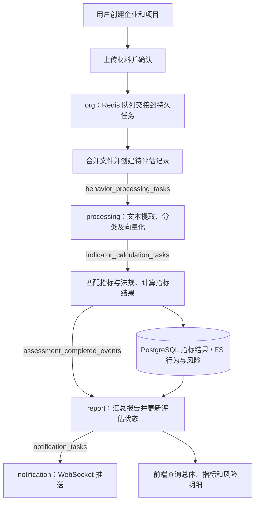

# 企业合规风险预警平台

Risk Warning Platform 是一个面向企业合规场景的风险评估后端项目。平台以企业和项目为管理单元，对上传的业务材料进行文本提取、行为分类和语义匹配，结合指标与法规知识库计算合规得分，汇总风险及其关联证据，并通过异步通知反馈评估结果。

项目采用 Spring Cloud 微服务架构，结合 Java 业务服务与 Python 模型服务，串联材料上传、行为分析、指标计算、报告查询和通知推送。本仓库包含后端、模型服务代码及部署参考文件，前端页面在独立项目中维护。

## 核心功能

| 功能 | 说明 |
| --- | --- |
| 用户与组织管理 | 邮箱密码注册、登录及 JWT 认证；企业、项目档案和成员管理；基于企业及项目角色的详情、修改、删除权限控制 |
| 材料上传 | 按项目初始化上传、接收文件分片、确认上传；后台合并原始文件并创建待评估记录 |
| 行为分析 | 提取 PDF、Word 等材料的文本，进行行为分类和向量化，将行为及向量写入 Elasticsearch |
| 指标与法规匹配 | 基于行为向量检索相关指标、法规，结合计算规则生成指标结果和风险记录 |
| 评估报告 | 提供总体结果、维度分布、指标得分、风险明细及关联行为描述，支持追溯评分依据 |
| 异步通知 | 通过 Kafka 传递处理任务与完成事件，通过 WebSocket 推送评估完成消息 |
| 任务恢复 | 使用 PostgreSQL 持久任务、Kafka inbox/outbox 和 Redis 原子交接，支持失败重试及重启后继续处理 |

企业角色包括 `admin / member`，项目角色包括 `project_admin / editor / viewer`。修改或删除项目时会检查活动评估及待处理任务，避免打断正在执行的计算。

## 技术架构

| 层次 | 技术及用途 |
| --- | --- |
| 服务框架 | Spring Boot 2.6.13、Spring Cloud 2021.0.5、Spring Cloud Alibaba 2021.0.5.0 |
| 服务入口 | Spring Cloud Gateway，统一路由及 JWT 校验 |
| 注册与配置 | Nacos，管理业务服务发现及共享配置 |
| 关系数据 | PostgreSQL、Spring Data JPA，保存用户、企业、项目、评估及指标结果 |
| 搜索与匹配 | Elasticsearch，保存行为、指标、法规和风险数据，并执行向量检索；Java 客户端版本为 8.11.4 |
| 向量服务 | BERT、PyTorch、Transformers、Flask；knowledge 模块另包含 Milvus 向量存储支持 |
| 异步处理 | Kafka、Spring Batch、PostgreSQL 持久任务 |
| 缓存与上传队列 | Redis |
| 文件解析 | Apache Tika、PDFBox、Apache POI |
| 部署参考 | Dockerfile、Docker Compose 和部分 Kubernetes 配置 |

### 模块划分

项目包含 8 个 Maven 模块：1 个公共模块和 7 个可运行服务。端口为仓库配置默认值，部署时以实际生效配置为准。

| 模块 | 默认端口 | 职责 |
| --- | --- | --- |
| `risk-warning-common` | — | 公共实体、DTO、鉴权、工具、消息定义及持久任务组件 |
| `risk-warning-gateway` | 8088 | 统一 API 入口、JWT 校验、HTTP 和 WebSocket 路由 |
| `risk-warning-org` | 8095 | 用户、企业、项目、文件上传及评估任务发起 |
| `risk-warning-processing` | 8084 | 文本处理、行为分类、语义匹配和指标计算 |
| `risk-warning-knowledge` | 8089 | 知识库向量化及向量存储能力 |
| `risk-warning-report` | 8093 | 风险汇总、评估完成处理及报告查询 |
| `risk-warning-notification` | 8091 / 9090 | HTTP 服务 / Netty WebSocket 通知服务 |
| `risk-warning-bert` | 8090 / 8000 | Java 模型服务接口 / 其管理的 Python 服务 |

## 评估流程



确认上传成功表示任务已提交，评估通过后台异步完成。报告使用请求中的评估 ID 查询持久化结果，企业和项目查询返回各自范围内最新创建的评估记录。

报告得分采用百分制：指标得分按原始得分与满分换算，总分和维度分按满分权重汇总，保留两位小数。高分代表低风险；总体风险等级沿用风险判定规则，不能仅根据总分推断。缺少有效指标时不会生成虚构的满分结果。

运行链路已移除模拟完成任务和固定报告。旧演示代码保存在 `documents/legacy-simulation/`，不参与 Maven 编译；历史模拟快照会提示重新上传原始材料评估。

## 项目结构

```text
Risk_Warning_Platform/
├── pom.xml                         # 父 POM、模块及依赖版本
├── .mvn/jvm.config                 # Maven JVM 编码配置
├── risk-warning-common/            # 公共模块与持久任务组件
├── risk-warning-gateway/           # API 网关
├── risk-warning-org/               # 用户、企业、项目及上传
├── risk-warning-processing/        # 行为分析与指标计算
├── risk-warning-knowledge/         # 知识库向量化与存储
├── risk-warning-report/            # 评估汇总与报告查询
├── risk-warning-notification/      # 消息通知与 WebSocket
├── risk-warning-bert/
│   ├── src/                        # Java 模型服务
│   ├── bert-service/               # Python 向量化服务及依赖
│   └── classify-service/           # Python 分类实现
├── documents/                      # 数据库脚本、接口及流程说明
│   ├── schema.sql
│   └── legacy-simulation/          # 历史演示代码归档
└── build/                          # Compose、Dockerfile 及 K8s 参考配置
```

## 开发与运行

### 环境准备

- Java：源码编译目标为 Java 8；Docker 构建使用 JDK 17，可优先使用 JDK 17 开发。
- Maven：建议 3.9.x。
- Python：准备兼容模型依赖的 Python 环境，依赖清单位于 `risk-warning-bert/bert-service/requirements.txt`。
- 基础设施：Nacos、PostgreSQL、Redis、Kafka、Elasticsearch；使用 Milvus 存储功能时另行准备 Milvus。
- 模型与知识库：准备 BERT 模型、分类模型所需文件，以及可供匹配的指标、法规和对应向量。

业务服务通过各模块 `bootstrap.yml`、`application.yml` 和公共 `bootstrap-common.yml` 加载配置。启动前核对 Nacos 地址、命名空间及共享配置，并配置数据库、Redis、Kafka、ES 连接信息。仓库中的环境值需要按实际部署调整。

模型服务需要配置 `bert.python.path`、`bert.python.script` 和模型路径；processing 的 `bert.service.url`、`knowledge.service.url`，以及 knowledge 的 `vectorization.api.local-api-url` 必须指向可访问的服务。跨容器或跨机器部署时，应使用对应服务地址。

### 构建与启动

在项目根目录构建并安装全部模块：

```bash
mvn clean install -DskipTests
```

准备好基础设施和配置后，可在 IDE 中运行各模块的 `*Application` 启动类，也可使用 Maven 启动单个服务，例如：

```bash
mvn -pl risk-warning-org spring-boot:run
```

建议先启动模型服务与 knowledge，再启动 processing、report、notification、org 和 gateway。确认模型接口可用、服务注册成功且消费者就绪后，再上传材料发起评估。

如需可执行 Spring Boot JAR，在完成上述构建后为目标服务执行打包，例如：

```bash
mvn -pl risk-warning-org package spring-boot:repackage -DskipTests
java -jar risk-warning-org/target/risk-warning-org-1.0.0.jar
```

容器部署参考 `build/docker-compose.yml`、`build/docker-compose-elasticsearch.yml` 和各服务的 Dockerfile。使用前需核对镜像构建路径、网络地址、配置来源和持久化目录，补齐实际环境所需的基础设施。

### 异步任务配置

| 配置 | 用途 |
| --- | --- |
| `UPLOAD_CONFIRM_QUEUE_KEY` | 隔离不同环境的上传队列；org 当前默认值为 `file:confirmed:queue:dcw` |
| `ASSESSMENT_WORK_NAMESPACE` | 持久任务的部署标识；org、processing、report 分别添加服务后缀，重启及迁移时应保持稳定 |
| `assessment.reliability.enabled` | 启用持久任务机制，相关服务当前配置为 `true` |
| `NOTIFICATION_WEBSOCKET_URI` | 网关连接 notification 的 WebSocket 地址，默认 `ws://localhost:9090` |

首次启动时，持久任务组件会初始化 `assessment_work` 表及索引，数据库账号需要相应权限。不同开发环境应协调上传队列、任务命名空间和 Kafka 消费配置。同一批任务的处理实例必须能够访问上传文件所在目录。

## 主要接口

下表为通过网关访问的路径。除注册、登录和明确放行的企业评估查询外，接口需要携带 `Authorization: Bearer <本地 JWT>`。响应沿用项目的 `Result` 包装，调用方需要同时检查业务结果。

| 方法 | 路径 | 功能 |
| --- | --- | --- |
| POST | `/api/org/user/register`、`/api/org/user/login` | 注册、登录 |
| GET | `/api/org/user/profile` | 当前用户资料 |
| GET / POST | `/api/org/enterprise`、`/api/org/project` | 企业、项目列表与创建 |
| GET / PUT / PATCH / DELETE | `/api/org/enterprise/{enterpriseId}` | 企业详情、修改、删除 |
| GET / PUT / PATCH / DELETE | `/api/org/project/{projectId}` | 项目详情、修改、删除 |
| POST | `/api/org/file/initUpload`、`/api/org/file/uploadChunk` | 初始化上传、提交分片 |
| POST | `/api/org/file/confirmUpload?projectId=...` | 确认上传，提交异步评估 |
| GET | `/api/org/project/{projectId}/assessment` | 项目最新评估 |
| GET | `/api/org/enterprise/{name}/assessment` | 企业最新评估，允许匿名访问；企业名称需 URL 编码 |
| GET | `/api/report/report/report/general/{assessmentId}` | 总体评估报告 |
| GET | `/api/report/report/report/indicatorResult/{assessmentId}` | 指标及维度得分、关联行为 |
| GET | `/api/report/report/report/risk?assessmentId=...` | 风险明细 |

报告路径中的重复 `report` 来自现有 controller 映射与网关前缀叠加。直连 report 服务时，移除 `/api/report` 前缀。WebSocket 网关路径为 `/api/notification/ws`，连接方式及鉴权需与前端实现配套。

## 验证与排查

运行本地回归测试，排除依赖在线基础设施的测试：

```bash
mvn test '-Dtest=*Test,!ConnectivityTest,!BatchTest,!ESSearchTest' '-Dsurefire.failIfNoSpecifiedTests=false'
```

2026-10-14 验证：8 个模块打包成功，74 项测试通过，1 项需显式启用的在线 ES 只读检查跳过。覆盖持久任务交接与恢复、真实上传执行、评估查询、报告评分、企业项目管理及 WebSocket 连接管理；该结果不代表线上端到端评估已通过。

遇到评估未完成时，可结合服务日志的 `AssessmentFlow`、`UPLOAD_HANDOFF`、`DURABLE_WORK`、`KAFKA_SEND ACK`，以及 `assessment_work` 的状态和错误信息逐段定位。确认上传、Kafka broker 确认、报告完成和浏览器收到通知分别代表不同阶段。

持久任务支持至少一次执行，文件操作和 ES 写入不能随数据库事务统一回滚；notification 的连接状态保存在实例内存中，多实例部署仍需配套通知路由。具体恢复方法见下方文档。

## 相关文档

- [恢复真实评估流程](documents/restore-real-assessment-flow.md)
- [评估流程可靠性与任务恢复](documents/assessment-reliability.md)
- [企业、项目管理接口](documents/enterprise-project-management-api.md)
- [百分制评分及前端取值](documents/assessment-percentage-scores.md)
- [指标关联行为](documents/indicator-related-behaviors.md)
- [数据库初始化脚本](documents/schema.sql)

当前用户认证使用本地邮箱密码和 JWT。统一身份认证平台 SSO 已完成方案分析，尚未接入当前代码。
